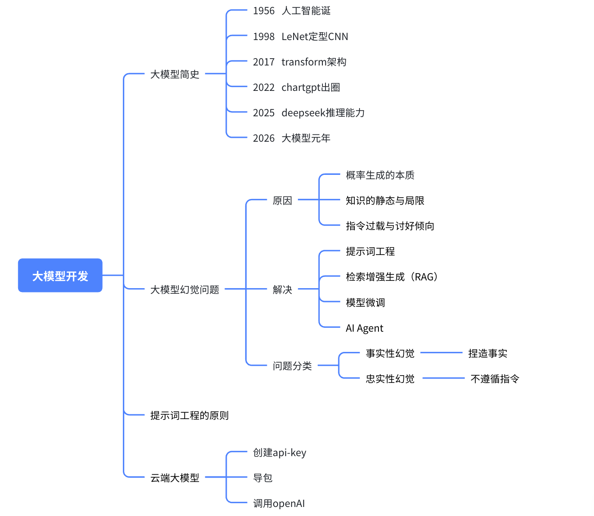

1.写xmind总结（今日所学内容）


2.安装好openai和dashscope库，并能基于API KEY完成基础对话
要求1：使用云端模型完成对话功能
要求2：调用云端模型完成对话功能，支持流失输出
```python
import os

from openai import OpenAI

client = OpenAI(
    api_key=os.getenv("DASHSCOPE_API_KEY"),
    base_url="https://ws-7nzksk72k8jv9jul.cn-beijing.maas.aliyuncs.com/compatible-mode/v1"
)

response = client.chat.completions.create(
    model="qwen-plus",
    messages=[
        {"role": "user", "content": "你是谁"}
    ]
)

print(response.choices[0].message.content)
```
```python
import os

from openai import OpenAI

client = OpenAI(
    api_key=os.getenv("DASHSCOPE_API_KEY"),
    base_url="https://ws-7nzksk72k8jv9jul.cn-beijing.maas.aliyuncs.com/compatible-mode/v1"
)

res = client.chat.completions.create(
    model="qwen-plus",
    messages=[
        {
            "role": "user",
            "content": "你是谁"
        }
    ],
    stream=True
)

for chunk in res:
    if not chunk.choices:
        continue
    
    content = chunk.choices[0].delta.content
    if content is not None:
        print(content, end='', flush=True)
```

3.设定AI角色为计算器，要求不废话直接给出结果，通过用户角色提问
比如提问2+5，要求AI直接回复5
提示，用到2个角色：system设定性格，user直接提问
```python
import os

from openai import OpenAI

client = OpenAI(
    api_key=os.getenv("DASHSCOPE_API_KEY"),
    base_url="https://ws-7nzksk72k8jv9jul.cn-beijing.maas.aliyuncs.com/compatible-mode/v1"
)

res = client.chat.completions.create(
    model="qwen-plus",
    messages=[
        {
            "role": "system",
            "content": "你是一个数学计算器，用户提出问题后直接给出结果，禁止给出分析、推理等过程；"
        },
        {
            "role": "user",
            "content": "2+5"
        }
    ],
    stream=True
)

for chunk in res:
    if not chunk.choices:
        continue
    
    content = chunk.choices[0].delta.content
    if content is not None:
        print(content, end='', flush=True)
```

4.智能客服机器人（基础对话）
需求：搭建一个电商客服问答机器人，回答退换货、物流等问题。
用户提问：我买的衣服尺码不合适能退吗？
```python
import os

from openai import OpenAI

client = OpenAI(
    api_key=os.getenv("DASHSCOPE_API_KEY"),
    base_url="https://ws-7nzksk72k8jv9jul.cn-beijing.maas.aliyuncs.com/compatible-mode/v1"
)

res = client.chat.completions.create(
    model="qwen-plus",
    messages=[
        {
            "role": "system",
            "content": "你是一个电商客服问答机器人，回答退换货、物流等问题"
        },
        {
            "role": "user",
            "content": "我买的衣服尺码不合适能退吗？"
        }
    ],
    stream=True
)

for chunk in res:
    if not chunk.choices:
        continue
    
    content = chunk.choices[0].delta.content
    if content is not None:
        print(content, end='', flush=True)
```

5.做一个"知识点讲解"助手，答案逐字输出，提升体验。
```python
import os

from openai import OpenAI

client = OpenAI(
    api_key=os.getenv("DASHSCOPE_API_KEY"),
    base_url="https://ws-7nzksk72k8jv9jul.cn-beijing.maas.aliyuncs.com/compatible-mode/v1"
)

def explain_stream(topic):
    stream = client.chat.completions.create(
        model="qwen-plus",
        messages=[
            {"role": "system", "content": "你是耐心的老师，用通俗语言讲解知识点。"},
            {"role": "user", "content": f"请讲解：{topic}"}
        ],
        stream=True
    )
    for chunk in stream:
        if not chunk.choices:
        continue
    
        content = chunk.choices[0].delta.content
        if content is not None:
            print(content, end='', flush=True)

explain_stream("什么是列表推导式")
```


