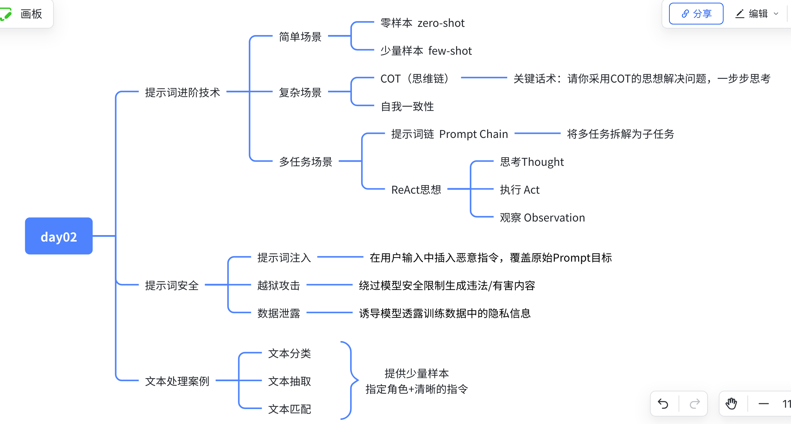

## 1.写xmind总结（今日所学内容）


## 2.基于金融电商项目完成以下需求：
### 2.1 LLM实现金融文本分类
#### 需求
- 下面几段文本来自某平台发布的金融领域文本：
```properties
1."今日，央行发布公告宣布降低利率，以刺激经济增长。这一降息举措将影响贷款利率，并在未来几个季度内对金融市场产生影响。",
2."ABC公司今日发布公告称，已成功完成对XYZ公司股权的收购交易。本次交易是ABC公司在扩大业务范围、加强市场竞争力方面的重要举措。据悉，此次收购将进一步巩固ABC公司在行业中的地位，并为未来业务发展提供更广阔的发展空间。详情请见公司官方网站公告栏",
3."公司资产负债表显示，公司偿债能力强劲，现金流充足，为未来投资和扩张提供了坚实的财务基础。",
4."最新的分析报告指出，可再生能源行业预计将在未来几年经历持续增长，投资者应该关注这一领域的投资机会",
```
- 我们的目的是期望模型能够帮助我们识别出这4段话中，每一句话描述的是一个什么类型的报告。因此，我们期望模型输出的结果为：
```properties
['新闻报道', '公司公告', '财务公告 '分析师报告']
```
```python
import os
from openai import OpenAI

type = ['新闻报道', '公司公告', '财务公告', '分析师报告']

class_examples = {
    "新闻报道": "今日，央行发布公告宣布降低利率，以刺激经济增长。这一降息举措将影响贷款利率，并在未来几个季度内对金融市场产生影响。",
    "公司公告": "ABC公司今日发布公告称，已成功完成对XYZ公司股权的收购交易。本次交易是ABC公司在扩大业务范围、加强市场竞争力方面的重要举措。据悉，此次收购将进一步巩固ABC公司在行业中的地位，并为未来业务发展提供更广阔的发展空间。详情请见公司官方网站公告栏。",
    "财务公告": "公司资产负债表显示，公司偿债能力强劲，现金流充足，为未来投资和扩张提供了坚实的财务基础。",
    "分析师报告": "最新的分析报告指出，可再生能源行业预计将在未来几年经历持续增长，投资者应该关注这一领域的投资机会。"
}


def init_prompt(user_question):
    system_prompt = f'你是一个金融领域类的数据分析专家，擅长从文本信息提取分类，指定分类有{type}'

    message = []
    message.append({"role": "system", "content": system_prompt})
    for key, value in class_examples.items():
        message.append({"role": "user", "content": value})
        message.append({"role": "assistant", "content": key})
    message.append({"role": "user", "content": user_question})

    return message

def chat_model(message):
    client = OpenAI(
        api_key=os.getenv("DASHSCOPE_API_KEY"),
        base_url='https://ws-7nzksk72k8jv9jul.cn-beijing.maas.aliyuncs.com/compatible-mode/v1'
    )
    res = client.chat.completions.create(
        model='qwen3.7-plus',
        messages=message
    )

    return res.choices[0].message.content

if __name__ == '__main__':
    question = input('请输入需要分析的文本：')
    res = init_prompt(question)
    result = chat_model(res)
    print(result)
```

### 2.2 LLM实现金融文本分类
### 需求
- 下面几段文本来自某平台发布的股票信息：
```properties
1.'2023-02-15，寓意吉祥的节日，股票佰笃[BD]美股开盘价10美元，虽然经历了波动，但最终以13美元收盘，成交量微幅增加至460,000，投资者情绪较为平稳。',
2.'2023-04-05，市场迎来轻松氛围，股票盘古(0021)开盘价23元，尽管经历了波动，但最终以26美元收盘，成交量缩小至310,000，投资者保持观望态度。',
```
- 我们的目的是期望模型能够帮助我们识别出这两段话中的SPO三元组信息。
这里定义的信息抽取Schema如下：
```properties
# 不同实体下的具备属性
schema = {
    '金融': ['日期', '股票名称', '开盘价', '收盘价', '成交量'],
}
```
期望抽取的结果如下：
```properties
{"日期": ["2023-02-15"], "股票名称": ["佰笃[BD]美股"], "开盘价": ["10美元"], "收盘价": ["13美元"], "成交量": ["460,000"]}
{"日期": ["2023-04-05"], "股票名称": ["盘古(0021)"], "开盘价": ["23元"], "收盘价": ["26美
```
```python
import json
import os

from openai import OpenAI

result_model = ["日期", "股票名称", "开盘价", "收盘价", "成交量"]
def init_prompt(user_question):
    system_prompt = f"你是一个擅长处理金融领域数据的文本信息抽取专家，能够按照指定的格式将用户问题输出符合此模版{result_model}的结果"
    message = []
    message.append({"role": "system", "content": system_prompt})

    list = [
        {
            "text": "2023-02-15，寓意吉祥的节日，股票佰笃[BD]美股开盘价10美元，虽然经历了波动，但最终以13美元收盘，成交量微幅增加至460,000，投资者情绪较为平稳。",
            "result": {
                "日期": ["2023-02-15"],
                "股票名称": ["佰笃[BD]美股"],
                "开盘价": ["10美元"],
                "收盘价": ["13美元"],
                "成交量": ["460,000"]
            }
        },
        {
            "text": "2023-04-05，市场迎来轻松氛围，股票盘古(0021)开盘价23元，尽管经历了波动，但最终以26美元收盘，成交量缩小至310,000，投资者保持观望态度。",
            "result": {
                "日期": ["2023-04-05"],
                "股票名称": ["盘古(0021)"],
                "开盘价": ["23元"],
                "收盘价": ["26美元"],
                "成交量": ["310,000"]
            }
        }
    ]
    for item in list:
        message.append({"role": "user", "content": item["text"]})
        message.append({"role": "assistant", "content": json.dumps(item["result"], ensure_ascii=False)})
    message.append({"role": "user", "content": user_question})

    return message

def chat_model(message):
    client = OpenAI(
        api_key=os.getenv("DASHSCOPE_API_KEY"),
        base_url='https://ws-7nzksk72k8jv9jul.cn-beijing.maas.aliyuncs.com/compatible-mode/v1'
    )
    res = client.chat.completions.create(
        model='qwen3.7-plus',
        messages=message
    )

    return res.choices[0].message.content

if __name__ == '__main__':
    user_question = input("请输入需要处理的文本: ")
    msg = init_prompt(user_question)
    res = chat_model(msg)
    print(res)
```

### 2.3 LLM实现金融文本匹配
### 需求
- 下面是几个金融方面的短文本对：
```properties
1.('股票市场今日大涨，投资者乐观。', '持续上涨的市场让投资者感到满意。'),
2.('油价大幅下跌，能源公司面临挑战。', '未来智能城市的建设趋势愈发明显。'),
3.('利率上升，影响房地产市场。', '高利率对房地产有一定冲击。'),
```
- 我们期望模型能够帮我们识别出这 3 对句子中，哪几对描述的是相似的语言。
即期望模型输出的结果为：
```properties
['相似', '不相似', '相似']
```python
import json
import os

from openai import OpenAI

data = [
    ('股票市场今日大涨，投资者乐观。', '持续上涨的市场让投资者感到满意。', '相似'),
    ('油价大幅下跌，能源公司面临挑战。', '未来智能城市的建设趋势愈发明显。', '不相似'),
    ('利率上升，影响房地产市场。', '高利率对房地产有一定冲击。', '相似')
]

def init_prompt(user_question):
    system_prompt = "你是一个分析金融领域的技术专家，擅长识别出用户提供的数据信息，如用户提供的两段话内容相似输出【相似】，如两段内容不相似输出【不相似】"

    message = []
    message.append({"role": "system", "content": system_prompt})

    for s1, s2, result in data:
        message.append({"role": "user", "content": f"第一句话是：{s1}，第二句话是：{s2}"})
        message.append({"role": "assistant", "content": json.dumps(result, ensure_ascii=False)})
    message.append({"role": "user", "content": user_question})

    return message

def chat_model(message):
    client = OpenAI(
        api_key=os.getenv("DASHSCOPE_API_KEY"),
        base_url='https://ws-7nzksk72k8jv9jul.cn-beijing.maas.aliyuncs.com/compatible-mode/v1'
    )
    res = client.chat.completions.create(
        model='qwen3.7-plus',
        messages=message
    )

    return res.choices[0].message.content

if __name__ == '__main__':
    user_question = input("请输入需要处理的文本：")
    msg = init_prompt(user_question)
    res = chat_model(msg)
    print(res)
```