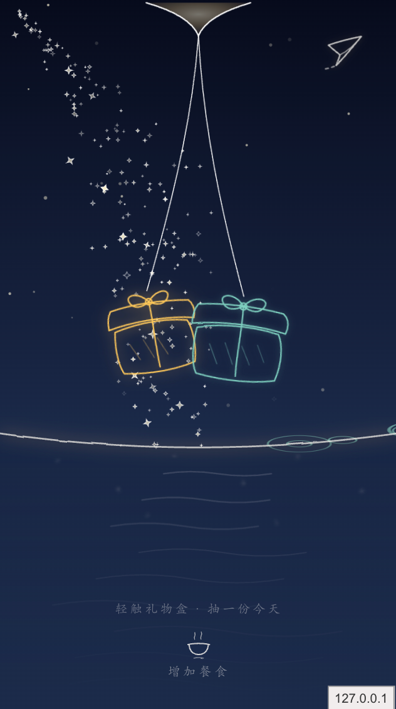
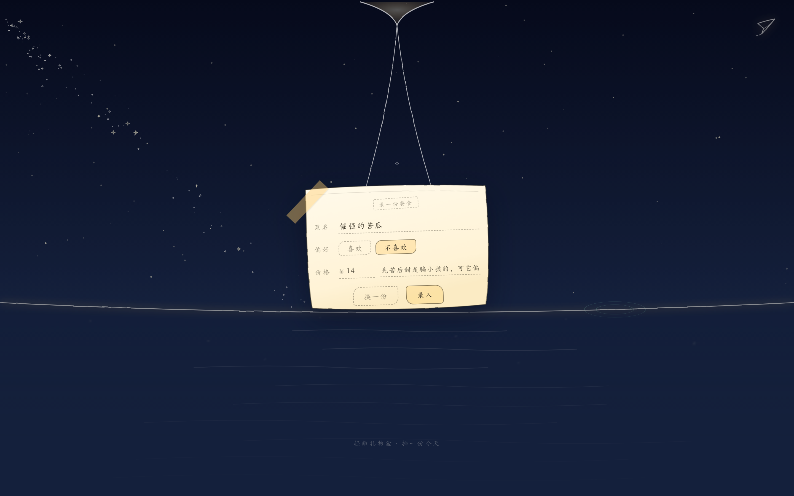
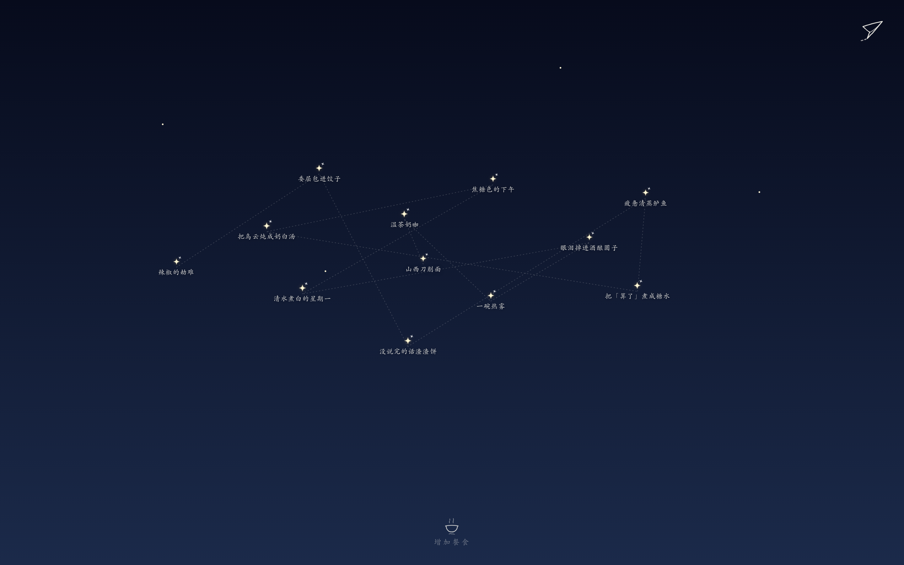
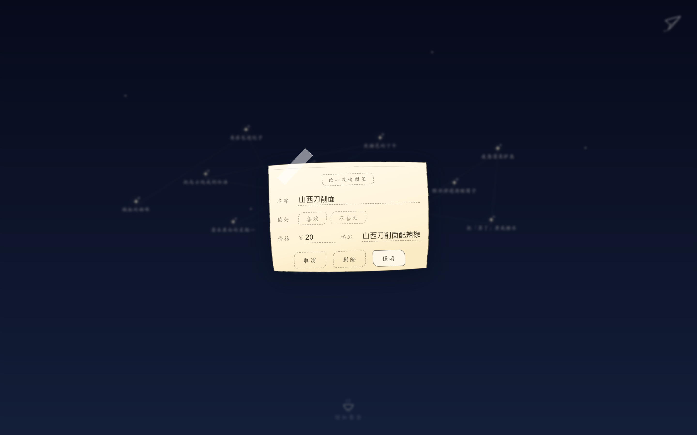

# 星湖盲盒 · 前端功能点清单

> 项目路径：`/Users/gao/Documents/HMSpace/food/star-lake-blind-box`
> 技术栈：React + TypeScript + Vite + CSS Modules，配图见 `docs/` 目录
> 更新时间：2026-11-18

---

## 一、主场景 · 天降礼物盒

<table>
  <tr>
    <td width="78%" align="center">
      
      桌面端 · 横屏视口
    </td>
    <td width="22%" align="center">
       
      移动端 · 竖屏视口
    </td>
  </tr>
</table>

| 功能点 | 说明 |
|---|---|
| 天空撕口 | 画面顶端平滑曲线撕口，内部透出淡淡日出暖光（渐变，无多余光晕） |
| 绳索吊盒 | 白色细绳从撕口尖端垂下，两只礼物盒悬于水面上方约 100px |
| 双盒心情语义 | 左盒暖金色 = 好心情；右盒青色 = 坏心情 |
| 白色线稿 | 盒身、缎带、蝴蝶结全部手绘线稿，roughen 抖动滤镜 |
| 呼吸发光 | drop-shadow 光晕 2.8s 呼吸 + 缩放脉动，左右盒节奏错开，无重影 |
| 待机动画 | 绳+盒作为「手臂」绕撕口尖端钟摆摇摆（4.4s / 3.9s 错频） |
| 主题适配 | 白天 / 夜晚双主题，线稿在浅色天空下自动补暗色柔光 |

## 二、抽取流程 · 点哪只晃哪只

| 功能点 | 说明 |
|---|---|
| 定点交互 | 按点击落点判定左 / 右半区，仅被点中的盒子做动效 |
| 动效时序 | 蓄力下沉 → 剧烈摇晃 → 盒盖飞出 + 星屑迸发 → 奖品浮现 |
| 非活动盒 | 未被点中的盒子保持轻柔摆动 |
| 空池提示 | 星星池为空时显示「池子空了」引导语 |

## 三、奖品便签

| 功能点 | 说明 |
|---|---|
| 手绘便签纸 | 歪斜边缘曲线 + roughen + 铅笔描边 + 内侧淡线，与整体线稿同风 |
| 45° 胶带 | 左上角半透明胶带斜贴 |
| 权重排版 | 礼物名（大字主角 + 手绘波浪线）→ 心情文案 → 邮戳标签 → 底部信息行 |
| 心情文案 | 每次抽取随机印一句（8 条，如「允许心情偶尔的乌云」） |
| 屏幕居中 | fixed 全屏居中，不被任何容器遮挡 |
| 关闭方式 | 点便签本体 / 点便签外任意区域（透明遮罩）/ 回车、空格 |
| 再抽一次 | 便签底部虚线按钮，点击重开整套抽取演出（规避 stale closure） |
| 稀有度显示 | 按 weight 显示 稀有 / 少见 / 寻常 + 价格 |

## 四、增加餐食 · 录入表单

| 功能点 | 说明 |
|---|---|
| 底部入口 | 手绘小碗图标（蒸汽 / 碗沿全曲线）+ 手写体「增加餐食」，悬停上浮 |
| 便签表单 | 菜名（必填，虚线填空）/ 偏好（喜欢 · 不喜欢分段）/ 价格（¥ 数字）/ 描述（≤100 字） |
| 预填逻辑 | 预填**只来自库外候选池**（《心灵餐饮》诗化菜名 18 道），不与数据库重名 |
| 换一份 | 随机换库外新候选，自动排除当前份；候选耗尽提示自行填写 |
| 录入查重 | 提交前查 `query_all_food`，同名菜 toast 拦截 |
| 入池 | 录入成功写入星星池，立即可在星空与盲盒中出现 |

## 五、星空收藏页

| 功能点 | 说明 |
|---|---|
| 纸飞机入口 | 右上角柔曲线稿纸飞机 + 加重虚线航迹；呼吸微光 + 轻微浮动引导点击；打开时静止常亮 |
| 12px 繁星 | 四角柔曲实心星光（无直线），微光呼吸 + 错峰闪烁 + 白色小星光 |
| 常显名字 | 星星名字来自 `query_all_food` 接口，11px + 文字投影 |
| 螺旋布点 | 黄金角螺旋 + 最小间距约束（含名字标签），铺满整页不重叠，确定性布局 |
| 星座连线 | 虚线按列表顺序串联星星 |
| 数据刷新 | **每次打开星空页**重新调 `query_all_food` 同步最新数据 |
| 投喂新星 | 双击天空（湖面以上）生成新星并直接弹出命名卡片 |

## 六、星星编辑卡片

| 功能点 | 说明 |
|---|---|
| 点击弹出 | 点星星或名字弹出编辑卡片（星空页不关闭） |
| 全字段编辑 | 名字 / 偏好 / 价格 / 描述全部可改，便签纸风格 |
| 保存 | `PUT /update_food/{id}` 全量提交，乐观更新 + 失败回滚 |
| 删除 | 卡片内直接删除，`DELETE /delete_food/{id}`，toast「沉入湖底」+ 撤销恢复 |
| 拖拽删除 | 星星向下拖入湖面溶解删除（手势保留） |
| 取消保护 | 新投喂未命名的星星取消时自动回收，不留垃圾数据 |

---

## 七、通用能力

| 功能点 | 说明 |
|---|---|
| 接口对接 | `query_all_food` / `add_food` / `update_food/{id}` / `delete_food/{id}` / `recommend_food?mood=`，全部验证通过 |
| 离线兜底 | 后端不可达时静默降级，变更仅留本地并标记离线 |
| Toast + 撤销 | 全局轻提示，删除类操作支持撤销 |
| 无障碍 | 关键操作 aria-label、srOnly 实时播报、`prefers-reduced-motion` 自动关闭动画 |
| 主题 | 白天 / 夜晚双主题（切换开关已暂时隐藏，月亮及其倒影已删除） |
